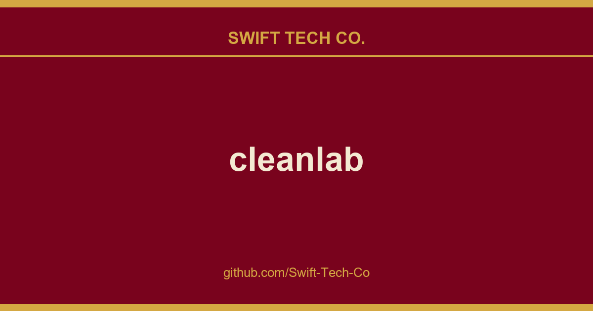

# cleanlab

## What This Is

A practical reference entry for product and engineering: the cleanlab notes, examples and fixes we reach for repeatedly. Kept current as part of the wider Swift Tech Co. engineering library.

## Images

[](https://github.com/Swift-Tech-Co/cleanlab)

## Run cleanlab open-source

This cleanlab package runs on Python 3.10+ and supports Linux, macOS, as well as Windows.

- Get started here! Install via `uv`, `pip`, or `conda`.
- Developers who install the bleeding-edge from source should refer to this master branch documentation.

**Practicing data-centric AI can look like this:**
1. Train initial ML model on original dataset.
2. Utilize this model to diagnose data issues (via cleanlab methods) and improve the dataset.
3. Train the same model on the improved dataset. 
4. Try various modeling techniques to further improve performance.

Most folks jump from Step 1 → 4, but you may achieve big gains without *any* change to your modeling code by using cleanlab!
Continuously boost performance by iterating Steps 2 → 4 (and try to evaluate with *cleaned* data).

[](https://github.com/Swift-Tech-Co/cleanlab)

## Use cleanlab with any model and in most ML tasks

All features of cleanlab work with **any dataset** and **any model**. Yes, any model: PyTorch, Tensorflow, Keras, JAX, HuggingFace, OpenAI, XGBoost, scikit-learn, etc.

cleanlab is useful across a wide variety of Machine Learning tasks. Specific tasks this data-centric AI package offers dedicated functionality for include:
1. Binary and multi-class classification
2. Multi-label classification (e.g. image/document tagging)
3. Token classification (e.g. entity recognition in text)
4. Regression (predicting numerical column in a dataset)
5. Image segmentation (images with per-pixel annotations)
6. Object detection (images with bounding box annotations)
7. Classification with data labeled by multiple annotators
8. Active learning with multiple annotators (suggest which data to label or re-label to improve model most)
9. Outlier detection (identify atypical data that appears out of distribution)

For other ML tasks, cleanlab can still help you improve your dataset if appropriately applied.
See our Example Notebooks and Blog.

## So fresh, so cleanlab

Beyond automatically catching all sorts of issues lurking in your data, this data-centric AI package helps you deal with **noisy labels** and train more **robust ML models**.
Here's an example:

```python

## Citation and related publications

cleanlab is based on peer-reviewed research. Here are relevant papers to cite if you use this package:

<details><summary><a href="https://github.com/Swift-Tech-Co/cleanlab">Confident Learning (JAIR '21)</a> (<b>click to show bibtex</b>) </summary>

        title={Confident Learning: Estimating Uncertainty in Dataset Labels},
        author={Curtis G. Northcutt and Lu Jiang and Isaac L. Chuang},
        journal={Journal of Artificial Intelligence Research (JAIR)},
        volume={70},
        pages={1373--1411},
        year={2021}
    }

</details>

<details><summary><a href="https://github.com/Swift-Tech-Co/cleanlab">Rank Pruning (UAI '17)</a> (<b>click to show bibtex</b>) </summary>

        author={Northcutt, Curtis G. and Wu, Tailin and Chuang, Isaac L.},
        title={Learning with Confident Examples: Rank Pruning for Robust Classification with Noisy Labels},
        booktitle = {Proceedings of the Thirty-Third Conference on Uncertainty in Artificial Intelligence},
        series = {UAI'17},
        year = {2017},
        location = {Sydney, Australia},
        numpages = {10},
        url = {https://github.com/Swift-Tech-Co/cleanlab
        publisher = {AUAI Press},
    }

</details>

<details><summary><a href="https://github.com/Swift-Tech-Co/cleanlab"> Label Quality Scoring (ICML '22)</a> (<b>click to show bibtex</b>) </summary>

        title={Model-agnostic label quality scoring to detect real-world label errors},
        author={Kuan, Johnson and Mueller, Jonas},
        booktitle={ICML DataPerf Workshop},
        year={2022}
    }

</details>

<details><summary><a href="https://github.com/Swift-Tech-Co/cleanlab"> Label Errors in Token Classification / Entity Recognition (NeurIPS '22)</a> (<b>click to show bibtex</b>) </summary>

        title={Detecting label errors in token classification data},
        author={Wang, Wei-Chen and Mueller, Jonas},
        booktitle={NeurIPS Workshop on Interactive Learning for Natural Language Processing (InterNLP)},
        year={2022}
    }

</details>

<details><summary><a href="https://github.com/Swift-Tech-Co/cleanlab"> Label Errors in Multi-Label Classification (ICLR '23)</a> (<b>click to show bibtex</b>) </summary>

        title={Identifying Incorrect Annotations in Multi-Label Classification Data},
        author={Thyagarajan, Aditya and Snorrason, Elías and Northcutt, Curtis and Mueller, Jonas},
        booktitle={ICLR Workshop on Trustworthy ML},
        year={2023}
    }

</details>

<details><summary><a href="https://github.com/Swift-Tech-Co/cleanlab"> Label Errors in Object Detection (ICML '23)</a> (<b>click to show bibtex</b>) </summary>

        title={ObjectLab: Automated Diagnosis of Mislabeled Images in Object Detection Data},
        author={Tkachenko, Ulyana and Thyagarajan, Aditya and Mueller, Jonas},
        booktitle={ICML Workshop on Data-centric Machine Learning Research},
        year={2023}
    }

</details>

<details><summary><a href="https://github.com/Swift-Tech-Co/cleanlab"> Label Errors in Image Segmentation (ICML '23)</a> (<b>click to show bibtex</b>) </summary>

        title={Estimating label quality and errors in semantic segmentation data via any model},
        author={Lad, Vedang and Mueller, Jonas},
        booktitle={ICML Workshop on Data-centric Machine Learning Research},
        year={2023}
    }

</details>

<details><summary><a href="https://github.com/Swift-Tech-Co/cleanlab"> Detecting Errors in Numerical Data (DMLR '24)</a> (<b>click to show bibtex</b>) </summary>

        title={Detecting Errors in a Numerical Response via any Regression Model},
        author={Zhou, Hang and Mueller, Jonas and Kumar, Mayank and Wang, Jane-Ling and Lei, Jing},
        booktitle={Journal of Data-centric Machine Learning Research},
        year={2024}
    }

</details>

<details><summary><a href="https://github.com/Swift-Tech-Co/cleanlab"> Out-of-Distribution Detection (ICML '22)</a> (<b>click to show bibtex</b>) </summary>

        title={Back to the Basics: Revisiting Out-of-Distribution Detection Baselines},
        author={Kuan, Johnson and Mueller, Jonas},
        booktitle={ICML Workshop on Principles of Distribution Shift},
        year={2022}
    }

</details>

<details><summary><a href="https://github.com/Swift-Tech-Co/cleanlab"> CROWDLAB for Data with Multiple Annotators (NeurIPS '22)</a> (<b>click to show bibtex</b>) </summary>

        title={CROWDLAB: Supervised learning to infer consensus labels and quality scores for data with multiple annotators},
        author={Goh, Hui Wen and Tkachenko, Ulyana and Mueller, Jonas},
        booktitle={NeurIPS Human in the Loop Learning Workshop},
        year={2022}
    }

</details>

<details><summary><a href="https://github.com/Swift-Tech-Co/cleanlab"> ActiveLab: Active learning with data re-labeling (ICLR '23)</a> (<b>click to show bibtex</b>) </summary>

        title={ActiveLab: Active Learning with Re-Labeling by Multiple Annotators},
        author={Goh, Hui Wen and Mueller, Jonas},
        booktitle={ICLR Workshop on Trustworthy ML},
        year={2023}
    }

</details>

<details><summary><a href="https://github.com/Swift-Tech-Co/cleanlab"> Detecting Dataset Drift and Non-IID Sampling (ICML '23)</a> (<b>click to show bibtex</b>) </summary>

        title={Detecting Dataset Drift and Non-IID Sampling via k-Nearest Neighbors},
        author={Cummings, Jesse and Snorrason, Elías and Mueller, Jonas},
        booktitle={ICML Workshop on Data-centric Machine Learning Research},
        year={2023}
    }

</details>

To understand/cite other cleanlab functionality not described above, check out our Blog.

## Other resources

- Example Notebooks demonstrating practical applications of this package

- Cleanlab Blog

- Blog post: Introduction to Confident Learning

- NeurIPS 2021 paper: Pervasive Label Errors in Test Sets Destabilize Machine Learning Benchmarks

- Introduction to Data-centric AI (MIT IAP Course)

- Release notes for past versions

**Interested in contributing?**  See the [contributing guide](CONTRIBUTING.md), [development guide](DEVELOPMENT.md), and ideas on useful contributions.

**Have questions?**  Check out our FAQ and Github Issues.

---

## Swift Tech Co.

Built and maintained by Swift Tech Co.

AI Automation | FinTech Platforms | Custom Software and Mobile Apps | SaaS Platforms | Cloud Infrastructure | Cybersecurity | SEO and Marketing | API Integration

**Join our community on Telegram:** [t.me/+Qt_eFvkb2rliMzNh](https://t.me/+Qt_eFvkb2rliMzNh)

Home | Services | Careers | Referral Program | Influencers | About | Contact

**Connect**

- Website: https://github.com/Swift-Tech-Co/cleanlab
- LinkedIn: [linkedin.com/in/stephenoladoke](https://www.linkedin.com/in/stephenoladoke/)
- LinkedIn (Company): [linkedin.com/company/swift-tech-co](https://www.linkedin.com/company/swift-tech-co)
- X: [@MrOladoke](https://x.com/MrOladoke)
- Instagram: [@mr.oladoke](https://www.instagram.com/mr.oladoke/)
- Instagram (Company): [@swifttechco](https://www.instagram.com/swifttechco/)
- Organization: [github.com/Swift-Tech-Co](https://github.com/Swift-Tech-Co)

## Sources

Compiled and maintained from upstream [cleanlab/cleanlab](https://github.com/cleanlab/cleanlab) under permissive open-source license.

---

Maintained by [Swift Tech Co.](https://github.com/Swift-Tech-Co) - [Telegram](https://t.me/+Qt_eFvkb2rliMzNh)

## Sources

Compiled and maintained from upstream [cleanlab/cleanlab](https://github.com/cleanlab/cleanlab) under permissive open-source license.

---

Maintained by [Swift Tech Co.](https://github.com/Swift-Tech-Co) - [Telegram](https://t.me/+Qt_eFvkb2rliMzNh)

## Sources

Compiled and maintained from upstream [cleanlab/cleanlab](https://github.com/cleanlab/cleanlab) under permissive open-source license.

---

Maintained by [Swift Tech Co.](https://github.com/Swift-Tech-Co) - [Telegram](https://t.me/+Qt_eFvkb2rliMzNh)